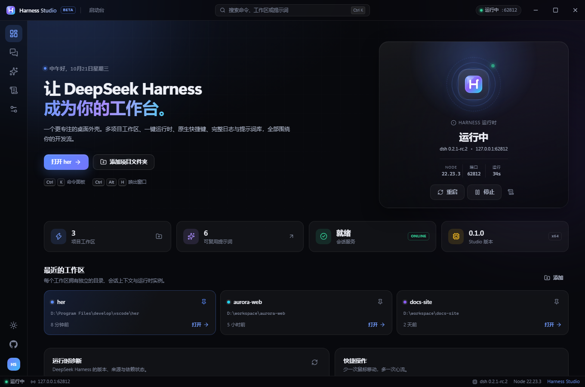
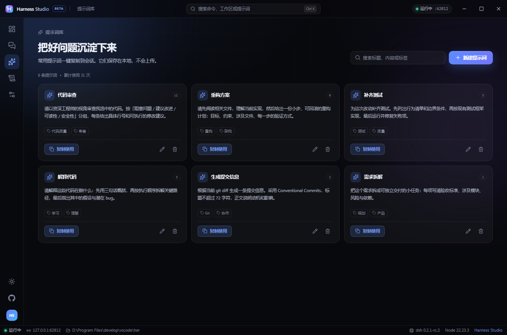
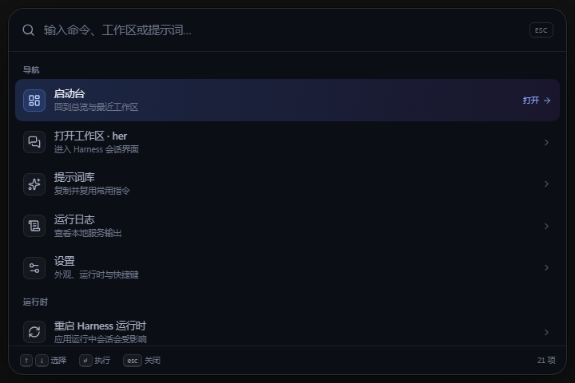

# Harness Studio

**A focused desktop workspace for DeepSeek Harness.** Not another chat client — one window for projects, runtime, prompts, logs, and the official Harness conversation UI.


[中文](README.md) · [Architecture](docs/ARCHITECTURE.md) · [Publishing](docs/PUBLISHING.md) · [Contributing](CONTRIBUTING.md)

> Harness Studio is an independent open-source project, **not an official DeepSeek product**. It reuses the [DeepSeek Harness](https://github.com/deepseek-ai/deepseek-harness) web runtime and conversation UI. It ships no model weights, accounts, or closed services.



## Why another desktop app?

The official DeepSeek Harness Desktop is a thorough Electron project with signed builds, built-in runtimes, update infrastructure, and platform integrations. It is excellent infrastructure — but source-only, and heavy for everyday use.

Harness Studio takes a different angle: **make one developer's daily loop feel fast.**

| Everyday workflow | Official Desktop | Harness Studio |
| --- | --- | --- |
| Distribution | build from source | Setup installer / portable exe |
| Runtime | bundled signed runtime | detects your `dsh`, or installs a portable runtime |
| Projects | single workspace | multiple workspaces, switch and restart the host |
| Prompts | — | 6 built-ins + your own, tags, usage counts |
| Logs | files on disk | live panel, filters, copy, token redaction |
| Command palette | — | `Ctrl+K` for commands, workspaces, prompts |
| Themes | follow system | dark / light / system + 6 accents |
| Tray & global keys | yes | yes, plus close/minimize to tray |
| Updates | official channel | checks GitHub Releases, downloads, restarts to install |

## Features

- **Studio dashboard** — host status, port, version, uptime, runtime diagnostics, recent workspaces.
- **Multi-workspace host management** — each workspace owns a project directory and an isolated `dsh web` process.
- **One-click runtime** — detect a local `dsh`, or download Node.js and install `@deepseek-ai/dsh` with live progress.
- **Official conversation UI** — embedded in a locked-down `<webview>`; no fork of model or tool behavior.
- **Prompt library** — built-ins plus your own, one-click copy into the chat.
- **Live logs** — stdout/stderr/system, filtering, auto-follow, token redaction.
- **Native shell** — tray, global shortcuts, close-to-tray, single instance, window-state restore.
- **Theming** — dark/light/system, accent colors, UI zoom, reduced motion.

<table>
  <tr>
    <td width="50%"></td>
    <td width="50%"></td>
  </tr>
</table>

## Quick start

### Download

Get the installer or portable build from [GitHub Releases](https://github.com/REPLACE_ME/harness-studio/releases) or [Gitee Releases](https://gitee.com/REPLACE_ME/harness-studio/releases).

> Builds are unsigned for now, so Windows SmartScreen may warn about an unknown publisher. Choose **More info → Run anyway**, or build from source.

### First run

1. Click **Choose folder** and pick a project.
2. Studio detects `dsh`; if missing, click **Install portable runtime**.
3. Start chatting with the same model, tools, and credentials as Harness (`~/.dsh`).

### From source

Requires Node.js 22+ and npm 10+.

```powershell
git clone https://github.com/REPLACE_ME/harness-studio.git
cd harness-studio
npm install
$env:ELECTRON_MIRROR = "https://npmmirror.com/mirrors/electron/"
node node_modules/electron/install.js
npm run dev
```

### Build installers

```powershell
$env:ELECTRON_BUILDER_BINARIES_MIRROR = "https://npmmirror.com/mirrors/electron-builder-binaries/"
npm run dist
```

## How it works

```
Electron main  →  spawns `dsh web` on 127.0.0.1:<free port>
      │                     │
      │ IPC                 │ launch-token URL
      ▼                     ▼
React workspace shell  →  <webview> official Harness UI
```

The renderer has no Node access. The webview only trusts the current host origin; external links open in the system browser. The launch token is redacted before anything is written to logs.

See [docs/ARCHITECTURE.md](docs/ARCHITECTURE.md) for the full design.

## Shortcuts

| Shortcut | Action |
| --- | --- |
| `Ctrl+K` | Command palette |
| `Ctrl+,` | Settings |
| `Ctrl+1` / `2` / `3` / `4` | Home / Workspace / Prompts / Logs |
| `Ctrl+Shift+L` | Live logs |
| `Ctrl+Alt+H` | Show / hide window globally |
| `Ctrl+Alt+K` | Open palette globally |

## Data locations

| Data | Path |
| --- | --- |
| Settings | `%APPDATA%\Harness Studio\settings.json` |
| Workspaces | `%APPDATA%\Harness Studio\workspaces.json` |
| Prompts | `%APPDATA%\Harness Studio\prompts.json` |
| Logs | `%APPDATA%\Harness Studio\logs\` |
| Portable runtime | `%APPDATA%\Harness Studio\runtime\` |
| Harness sessions / credentials | `~/.dsh` (shared with the `dsh` CLI) |

The portable build keeps its data next to the executable in `HarnessStudioData/`.

## Development

```powershell
npm run dev          # Electron + HMR
npm run typecheck    # main + renderer
npm run build        # build out/
npm run preview:ui   # browser-only UI preview with mocked IPC
npm run icons        # regenerate icons from resources/brand.svg
```

## Publishing

The repo ships CI and release workflows plus a full guide:

- `docs/PUBLISHING.md` — GitHub Actions release, Gitee mirror, manual upload, versioning.
- Replace the `REPLACE_ME` values in `src/shared/defaults.ts`, `package.json`, `electron-builder.yml`, and this README before releasing.

## Roadmap

- [ ] Session insights: tokens, cost, daily trends
- [x] Auto-update via `electron-updater` (GitHub Releases)
- [ ] Multi-tab workspaces
- [ ] Global quick-ask (`Alt+Space`)
- [ ] Plugin marketplace entry
- [ ] macOS builds and signing

## License

[MIT](LICENSE) © 2026 Harness Studio Contributors

DeepSeek Harness is MIT-licensed and maintained by the DeepSeek team. This project is not affiliated with DeepSeek.
