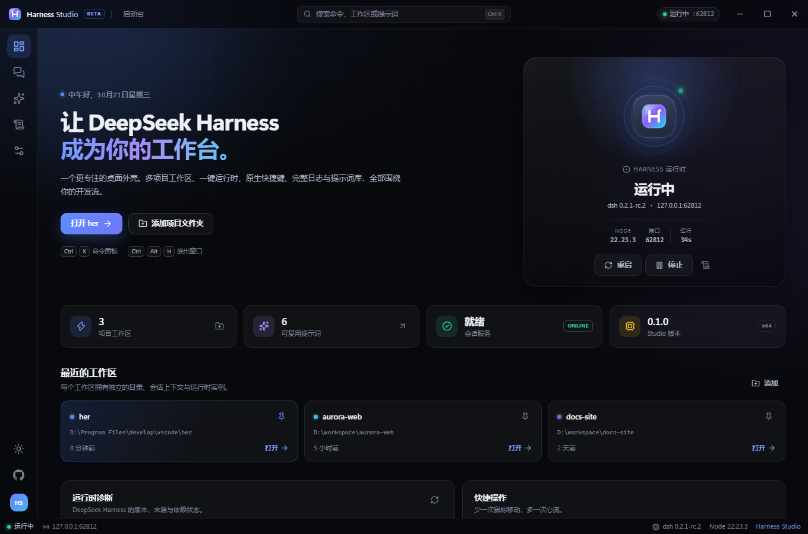
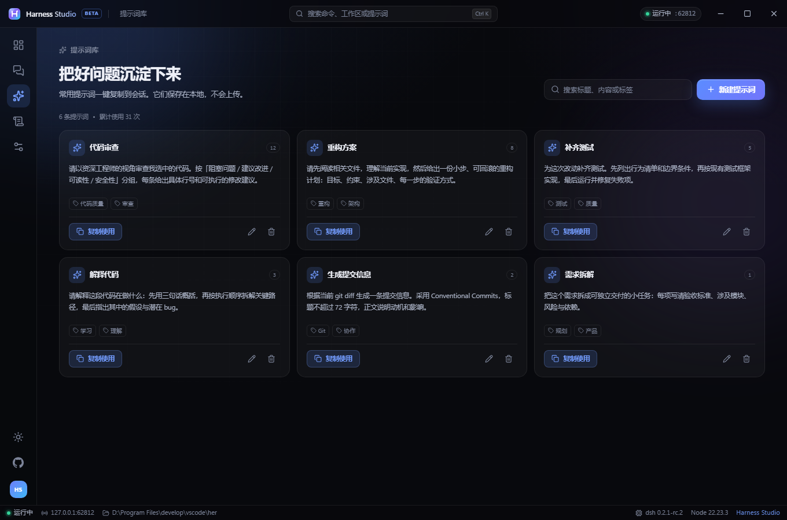
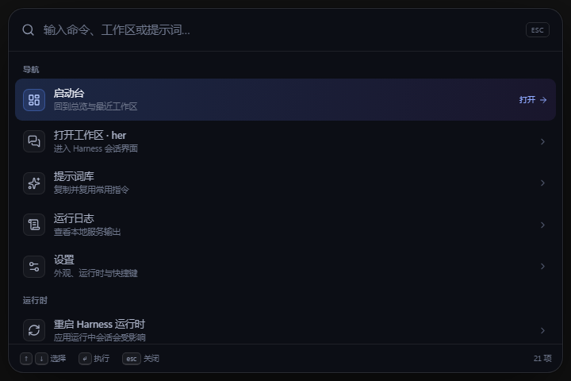

# Harness Studio

**A focused desktop workspace for DeepSeek Harness.** Not another chat client — one window for projects, runtime, prompts, logs, and the official Harness conversation UI.


[中文](README.md) · [Architecture](docs/ARCHITECTURE.md) · [Publishing](docs/PUBLISHING.md) · [Contributing](CONTRIBUTING.md)

> Harness Studio is an independent open-source project, **not an official DeepSeek product**. It reuses the [DeepSeek Harness](https://github.com/deepseek-ai/deepseek-harness) web runtime and conversation UI. It ships no model weights, accounts, or closed services.



## Why another desktop app?

The official DeepSeek Harness Desktop is a thorough Electron project with signed builds, built-in runtimes, update infrastructure, and platform integrations. It is excellent infrastructure — but source-only, and heavy for everyday use.

Harness Studio takes a different angle: **make one developer's daily loop feel fast.**

| Everyday workflow | Official Desktop | Harness Studio |
| --- | --- | --- |
| Distribution | build from source | Setup installer / portable exe |
| Runtime | bundled signed runtime | detects your `dsh`, or installs a portable runtime |
| Projects | single workspace | multiple workspaces, switch without restarting the host |
| Prompts | — | 6 built-ins + your own, tags, usage counts |
| Logs | files on disk | live panel, filters, copy, token redaction |
| Session insights | — | tokens, cache hit rate, cost estimate, 14-day trend, per-model and per-workspace breakdown |
| Global quick ask | — | `Ctrl+Alt+Space` popup, sends straight to the active session |
| Command palette | — | `Ctrl+K` for commands, workspaces, prompts |
| Themes | follow system | dark / light / system + 6 accents |
| Tray & global keys | yes | yes, plus close/minimize to tray |
| Updates | official channel | checks GitHub Releases, downloads, restarts to install |

## Features

- **Studio dashboard** — host status, port, version, uptime, runtime diagnostics, recent workspaces.
- **Workspace switching** — Studio registers the project directory and opens it in the active tab, then verifies the session's working directory. Other tabs keep their conversations and drafts, and all tabs reuse one `dsh web` host. Project names and paths also follow navigation inside Harness.
- **Session tabs** — several Harness conversations side by side in one window (`Ctrl+T` new, `Ctrl+W` close, `Ctrl+Tab` / `Ctrl+Shift+Tab` switch). Tabs share one runtime and switch without reloading; each is its own renderer process, so the count is capped (4 by default, 1–8 in Settings → General).
- **One-click runtime** — detect a local `dsh`, or download Node.js 22 and install the verified `@deepseek-ai/dsh@0.2.1-rc.2` with live progress. This fixed version keeps installation compatible when upstream `latest` changes its Node.js requirements.
- **Official conversation UI** — embedded in a locked-down `<webview>`; no fork of model or tool behavior.
- **Prompt library** — built-ins plus your own, one-click copy into the chat.
- **Live logs** — stdout/stderr/system, filtering, auto-follow, token redaction.
- **Session insights** — reads `~/.dsh` locally: token usage, cache hit rate, cost estimate with configurable pricing, 14-day trend, per-model and per-workspace breakdown, sortable session table.
- **Native shell** — tray, global shortcuts, close-to-tray, single instance, window-state restore.
- **Theming** — dark/light/system, accent colors, UI zoom, reduced motion.
- **Conversation reading size (v0.1.11)** — Follow Harness or choose 14, 16, or 18 px in Settings → Appearance. Saved changes update conversation text in every tab immediately and can be reset.
- **Interface language (v0.1.8)** — choose Chinese, English, or Follow system in Settings → General. The saved choice updates the main window, command palette, quick ask, dates, tray, menus, and confirmation dialogs without reloading sessions or clearing drafts.

The language setting applies to the Studio shell. The official Harness interface, conversation content, saved prompts, and raw logs stay as they are. Existing errors and installation progress snapshots keep the language used when generated. Interface languages are available from v0.1.8 on both GitHub and Gitee.

**Plugin manager (v0.1.9)** is available in Home quick actions and the command palette. It returns to the workspace and opens the built-in Harness manager in the active tab once the runtime is ready. An unavailable entry shows a message. Harness handles installation, enabling, configuration, and sources; there is no default official plugin marketplace. See the [Harness plugin manager guide](https://github.com/deepseek-ai/deepseek-harness/blob/master/packages/client/ui-plugin-manager/README.md). The entry has been available since v0.1.9, which was published on GitHub and Gitee with full public installer download verification complete on both platforms.

**Session input focus (v0.1.10)** fixes typing that stayed in a background conversation after switching to the previous tab. Tab changes coordinate DOM and native input focus, leaving the workspace returns input to Studio, and loading preserves an active toolbar input. This fix is included in the current local installation. v0.1.10 is published on GitHub and Gitee, with package and full public installer download verification complete on both platforms. Automated Win32 checks passed for both tab directions, cross-page input, and send confirmation; physical keyboard results remain pending.

When returning to a project with only an unsent draft, Harness may open a new blank session because the sidebar hides inactive blank sessions. Keep the original tab open when you need to preserve a draft. Removing a Studio workspace removes its bookmark and keeps the shared host running.

<table>
  <tr>
    <td width="50%"></td>
    <td width="50%"></td>
  </tr>
</table>

## Quick start

### Download

Get the installer or portable build from [GitHub Releases](https://github.com/yunhanhai/harness-studio/releases) or [Gitee Releases](https://gitee.com/yunhanhai/harness-studio/releases).

Current downloads: GitHub and Gitee both provide v0.1.11; the public installer downloads have been fully verified on both platforms.

> Builds are unsigned for now, so Windows SmartScreen may warn about an unknown publisher. Choose **More info → Run anyway**, or build from source.

### First run

1. Click **Choose folder** and pick a project.
2. Studio detects `dsh`; if missing, click **Install portable runtime**.
3. Start chatting with the same model, tools, and credentials as Harness (`~/.dsh`).

### From source

Requires Node.js 22+ and npm 10+.

```powershell
git clone https://github.com/yunhanhai/harness-studio.git
cd harness-studio
npm install
$env:ELECTRON_MIRROR = "https://npmmirror.com/mirrors/electron/"
node node_modules/electron/install.js
npm run dev
```

### Build installers

```powershell
$env:ELECTRON_BUILDER_BINARIES_MIRROR = "https://npmmirror.com/mirrors/electron-builder-binaries/"
npm run dist
```

## Model setup and DSH skill center (development version)

Settings, Home, and the command palette now offer model setup. First use presents **Use a custom model / Sign in to DeepSeek / Configure later**. Third-party APIs and local compatible services do not require a DeepSeek account. Harness retains its native model forms and credential storage. A local server that does not validate keys can use `local-placeholder` with the current adapter; authenticated servers require their own key. Reply generation and tool support depend on the configured API and model.

The sidebar and `Ctrl+6` open the DSH skill center: source and scope labels, search, instruction/resource preview, invalid declarations, and local name conflicts. Standard project `.dsh/skills` and current DSH_HOME `skills` support creation, Markdown or complete-folder import, editing with backups, deletion, and restore. Supporting files and empty folders are preserved. Shared agents, custom, and bundled sources are read only.

This is a default disk inventory with statically identified custom candidates. Full preset composition, virtual/remote providers, and the live invocation catalog are not included; check the Harness `/` menu for availability and refresh. Backups are stored under Studio data in `skill-backups` and cannot overwrite subsequent edits. Plugin picks link to community projects and official discovery documentation; installation remains in Harness and plugin combinations are not Studio-verified.

These changes are **Unreleased**. Downloads and the local installation remain v0.1.11.

## How it works

```
Electron main  →  spawns `dsh web` on 127.0.0.1:<free port>
      │                     │
      │ IPC                 │ launch-token URL
      ▼                     ▼
React workspace shell  →  <webview> official Harness UI
```

The renderer has no Node access. The webview only trusts the current host origin; external links open in the system browser. The launch token is redacted before anything is written to logs.

See [docs/ARCHITECTURE.md](docs/ARCHITECTURE.md) for the full design.

## Shortcuts

| Shortcut | Action |
| --- | --- |
| `Ctrl+K` | Command palette |
| `Ctrl+,` | Settings |
| `Ctrl+1` / `2` / `3` | Home / Workspace / Insights |
| `Ctrl+4` / `5` | Prompts / Logs |
| `Ctrl+6` | DSH skill center (development version) |
| `Ctrl+T` / `Ctrl+W` | New / close session tab |
| `Ctrl+Tab` / `Ctrl+Shift+Tab` | Next / previous session tab |
| `Ctrl+Alt+H` | Show / hide window globally |
| `Ctrl+Alt+K` | Open palette globally |
| `Ctrl+Alt+Space` | Global quick ask (sends to the active session) |

## Data locations

| Data | Path |
| --- | --- |
| Settings | `%APPDATA%\Harness Studio\settings.json` |
| Workspaces | `%APPDATA%\Harness Studio\workspaces.json` |
| Prompts | `%APPDATA%\Harness Studio\prompts.json` |
| Logs | `%APPDATA%\Harness Studio\logs\` |
| Portable runtime | `%APPDATA%\Harness Studio\runtime\` |
| Harness sessions / credentials | `~/.dsh` (shared with the `dsh` CLI) |

The portable build keeps its data next to the executable in `HarnessStudioData/`.

## Development

```powershell
npm run dev          # Electron + HMR
npm run typecheck    # main + renderer
npm run test:conversation-font # reading size settings and preload regressions
npm run build        # build out/
npm run preview:ui   # browser-only UI preview with mocked IPC
npm run icons        # regenerate icons from resources/brand.svg
```

## Publishing

The repo ships CI and release workflows plus a full guide:

- `docs/PUBLISHING.md` — GitHub Actions release, Gitee mirror, manual upload, versioning.
- The repo is configured for `yunhanhai/harness-studio`. If you fork it, update the owner in `src/shared/defaults.ts`, `package.json`, `electron-builder.yml`, and both READMEs.

## Roadmap

- [x] Session insights: tokens, cache hit rate, cost, daily trends
- [x] Auto-update via `electron-updater` (GitHub Releases)
- [x] Global quick-ask (`Ctrl+Alt+Space`)
- [x] Host crash auto-recovery with backoff
- [x] Session tabs on one shared runtime
- [x] Built-in Harness plugin manager entry (v0.1.9)
- [ ] macOS builds and signing
- [x] English UI (v0.1.8)

## License

[MIT](LICENSE) © 2026 Harness Studio Contributors

DeepSeek Harness is MIT-licensed and maintained by the DeepSeek team. This project is not affiliated with DeepSeek.
