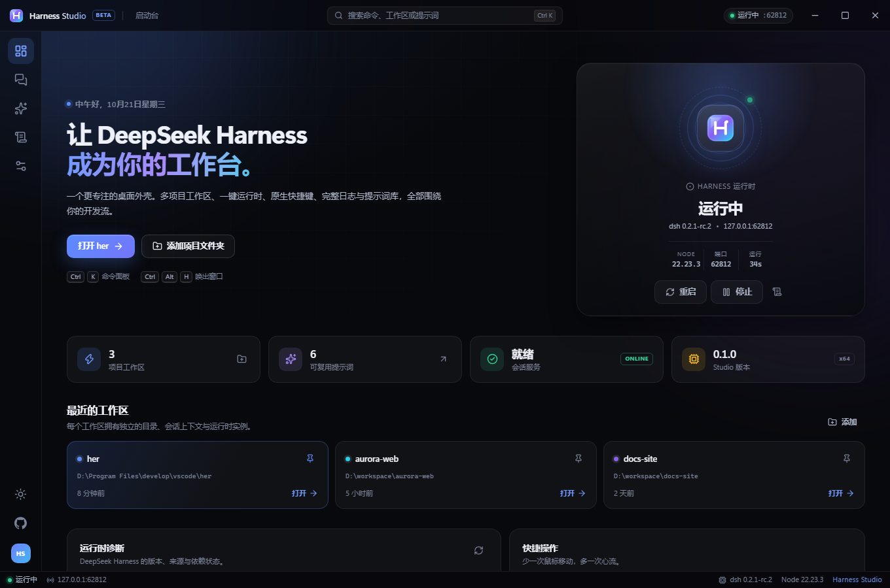
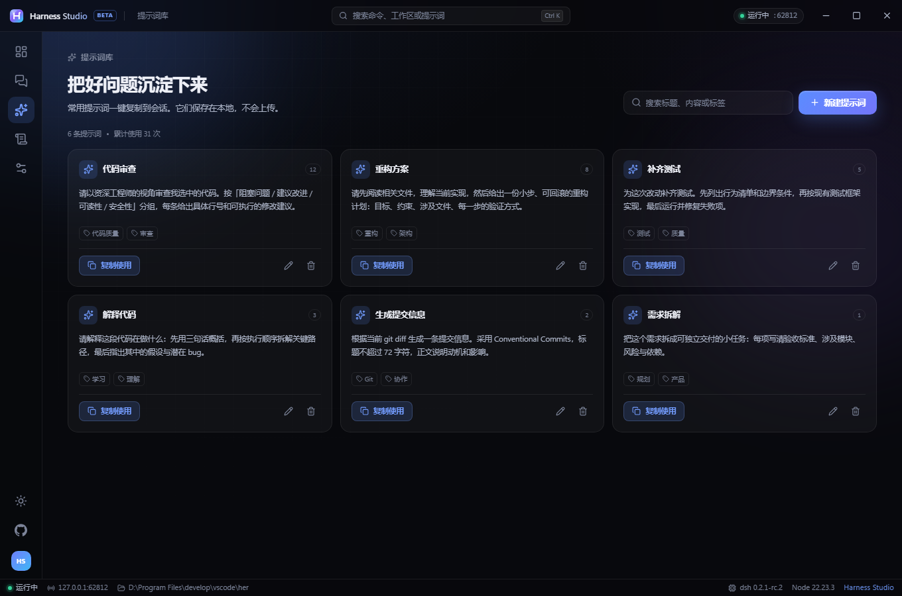
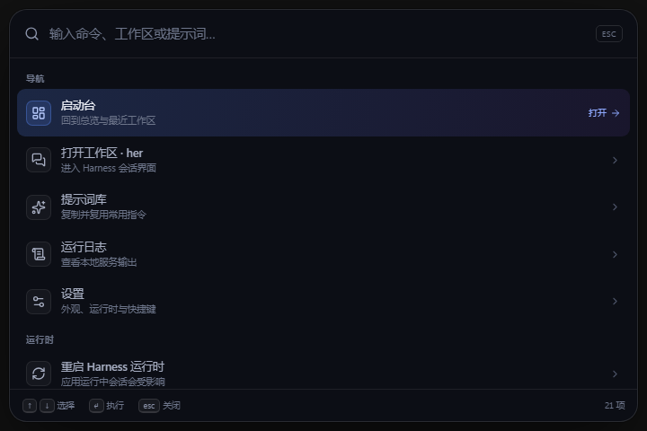
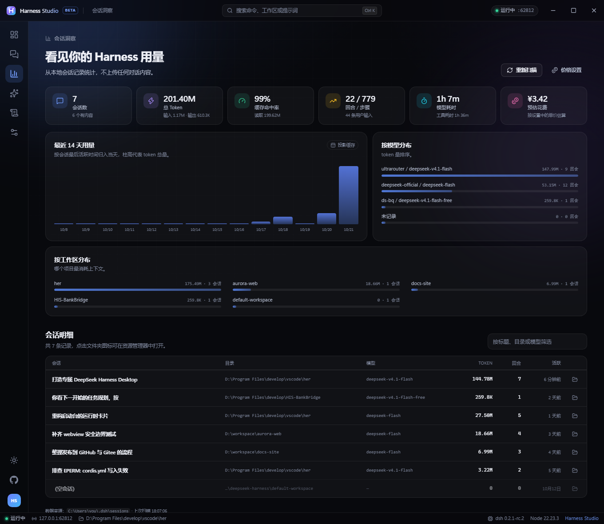

# Harness Studio

**A desktop workspace for DeepSeek Harness.** Manage projects, conversations, models, skills, prompts and the local runtime in one window.

> **Project support** · Thanks to [艺の公益站](https://ultrarouter.org/sign-up?aff=KnwD) for supporting Harness Studio.

[](https://github.com/yunhanhai/harness-studio/releases) [](https://gitee.com/yunhanhai/harness-studio/releases)  [](LICENSE) 

[Download](#download) · [Quick start](#quick-start) · [Features](#features) · [Development progress](#development-progress) · [Documentation](#documentation) · [中文](README.md)

Harness Studio is an independent open-source project, unaffiliated with DeepSeek. Its runtime and conversation UI come from [DeepSeek Harness](https://github.com/deepseek-ai/deepseek-harness).



## Download

Current public release: **v0.1.12** · **Windows 10/11 x64**

| Source | Installer | Portable |
| --- | --- | --- |
| GitHub | [Setup.exe](https://github.com/yunhanhai/harness-studio/releases/download/v0.1.12/Harness-Studio-0.1.12-x64-Setup.exe) | [Portable.exe](https://github.com/yunhanhai/harness-studio/releases/download/v0.1.12/Harness-Studio-0.1.12-x64-Portable.exe) |
| Gitee | [Setup.exe](https://gitee.com/yunhanhai/harness-studio/releases/download/v0.1.12/Harness-Studio-0.1.12-x64-Setup.exe) | [Portable.exe](https://gitee.com/yunhanhai/harness-studio/releases/download/v0.1.12/Harness-Studio-0.1.12-x64-Portable.exe) |

- **Installer:** desktop and Start menu shortcuts, with automatic updates.
- **Portable:** no installation; data stays in `HarnessStudioData/` beside the executable.

Release notes: [GitHub Releases](https://github.com/yunhanhai/harness-studio/releases) · [Gitee Releases](https://gitee.com/yunhanhai/harness-studio/releases)

Builds are currently unsigned and Windows may report an unknown publisher; verify the download source. See [acceptance records](docs/ACCEPTANCE.md) for build and release verification.

## Quick start

1. Open Studio and choose a project folder.
2. Let Studio detect your local `dsh`, or select **Install portable runtime**.
3. Open the workspace and configure a model in Harness's native form: a custom API, compatible local service or DeepSeek account.
4. Open the skill center, plugin manager or another conversation tab as needed.

Custom APIs and compatible local services do not require a DeepSeek account. Configure the endpoint, protocol, model ID and any service credentials. The built-in installer pins Node.js 22 and `@deepseek-ai/dsh@0.2.1-rc.2`; check the Node.js requirements when selecting another DSH version.

## Features

| Capability | Everyday use |
| --- | --- |
| Projects and conversation tabs | Open a project in the active tab; conversations share one Host, with a default limit of four tabs configurable to one–eight |
| Model settings | Enter Harness's native forms for compatible APIs and local services; capabilities depend on the model and protocol |
| DSH skill center | Search and manage standard project/user skills, import complete folders, edit with backups and restore |
| Plugin manager | Open Harness's own manager in the active conversation |
| Prompts and quick ask | Keep reusable prompts and send or insert into the active conversation with global shortcuts |
| Logs and insights | Inspect local logs, tokens, cache-hit rate, model/workspace usage and estimated costs |
| Desktop experience | Tray, shortcuts, crash recovery, themes, reading size and Chinese/English UI |

[Feature details and usage limits](docs/FEATURES.en.md)

<details>
<summary>More screenshots: prompts, command palette and session insights</summary>







</details>

## Development progress

These are **unpublished development records**, absent from the public v0.1.12 packages. Future release notes will define availability.

| Area | Completed development work |
| --- | --- |
| Diagnostics and recovery | Configuration checks, local snapshots, restoration backups, identified-plugin disabling and dependency repair |
| Profile management | Inventory, labels/notes, fixed configuration copying, fully stopped selection and diagnostic refresh |
| Plugin catalog | Offline browsing, search/filtering, version/license evidence and scoped test status |
| Download resilience | Bounded retries, actionable failures and optional built-in fallback sources; custom sources never switch automatically |

Full environment presets, version libraries and active switching remain planned. Profile copies share global `DSH_HOME` configuration and may retain credentials; keep copies and snapshots local. See [development details](docs/FEATURES.en.md#development-records-and-architecture).

## Run from source

Requires **Windows 10/11 x64, Node.js 22+ and npm 10+**. See [Contributing](CONTRIBUTING.md) for development requirements and build dependencies.

```powershell
git clone https://github.com/yunhanhai/harness-studio.git
cd harness-studio
npm install --ignore-scripts
$env:ELECTRON_MIRROR = "https://npmmirror.com/mirrors/electron/"
node node_modules/electron/install.js
npm run dev
```

| Command | Purpose |
| --- | --- |
| `npm run dev` | Electron development with hot reload |
| `npm run typecheck` | Main and renderer type checks |
| `npm run build` | Build to `out/` |
| `npm run preview:ui` | Browser preview with simulated data |
| `npm run dist` | Build Windows installer and portable packages |

See [local installation](docs/LOCAL-INSTALL.md) and the [publishing guide](docs/PUBLISHING.md) for deployment and packaging.

## Shortcuts

| Shortcut | Action |
| --- | --- |
| `Ctrl+K` / `Ctrl+,` | Command palette / Settings |
| `Ctrl+1`–`Ctrl+6` | Home, workspace, insights, prompts, logs and skills |
| `Ctrl+T` / `Ctrl+W` | New / close conversation tab |
| `Ctrl+Tab` / `Ctrl+Shift+Tab` | Switch conversation tabs |
| `Ctrl+Alt+H` / `Ctrl+Alt+K` | Show window / command palette globally |
| `Ctrl+Alt+Space` | Global quick ask |

Configure global shortcuts in Settings → General.

## Documentation

| Topic | Guide |
| --- | --- |
| Features and limits | [Feature details](docs/FEATURES.en.md) |
| Runtime, data and architecture | [Architecture](docs/ARCHITECTURE.md) |
| Contributing | [Contributing](CONTRIBUTING.md) · [Handoff](docs/HANDOFF.md) |
| Installing, packaging and publishing | [Local install](docs/LOCAL-INSTALL.md) · [Publishing](docs/PUBLISHING.md) |
| Changes and verification | [Changelog](CHANGELOG.md) · [Acceptance](docs/ACCEPTANCE.md) |
| Issues and suggestions | [GitHub Issues](https://github.com/yunhanhai/harness-studio/issues) · [Gitee Issues](https://gitee.com/yunhanhai/harness-studio/issues) |

## Thanks and license

Thanks to [艺の公益站](https://ultrarouter.org/sign-up?aff=KnwD) for project support, to [DeepSeek Harness](https://github.com/deepseek-ai/deepseek-harness) for the runtime, Agent and Web UI, and to all contributors.

Built with [Electron](https://www.electronjs.org/), [React](https://react.dev/), [Vite](https://vite.dev/) and [Tailwind CSS](https://tailwindcss.com/); icons by [Lucide](https://lucide.dev/).

[MIT](LICENSE) © 2026 Harness Studio Contributors. DeepSeek names and trademarks belong to their respective owners. Model costs and data-use terms depend on your selected service.
