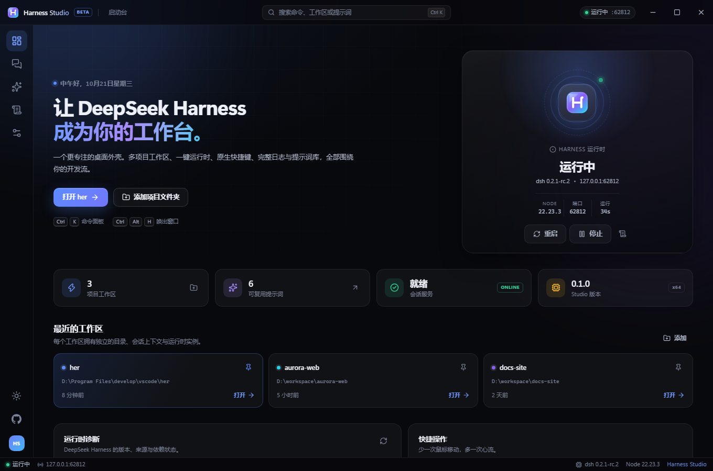
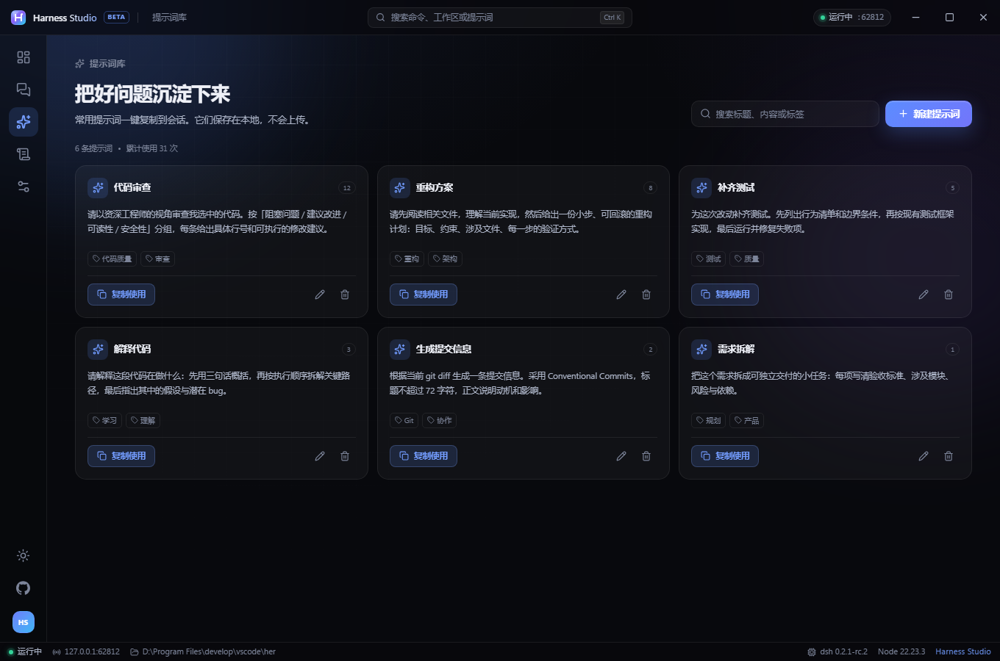
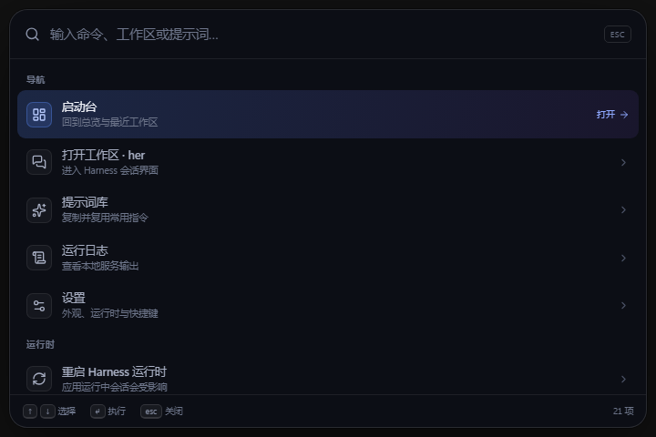
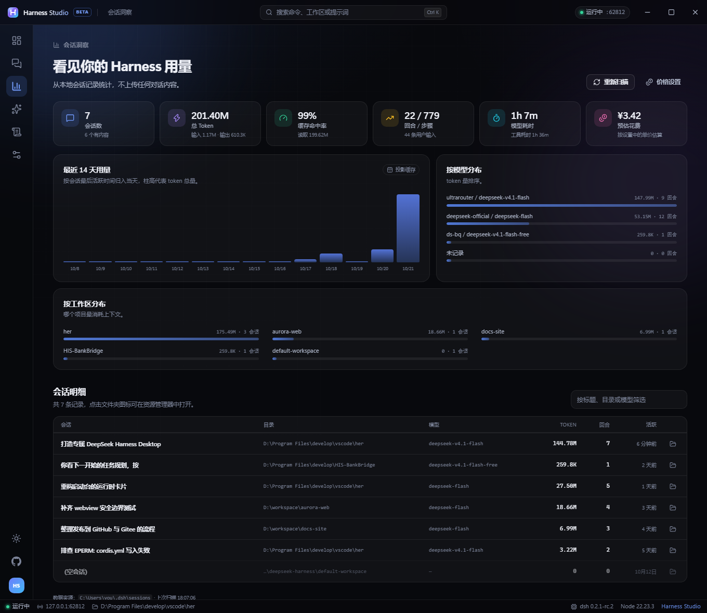

# Harness Studio · 深寻工作台

**为 DeepSeek Harness 打造的桌面工作台。** 在一个窗口中管理项目、会话、模型、技能、提示词与本地运行时。

> **项目支持** · 感谢 [艺の公益站](https://ultrarouter.org/sign-up?aff=KnwD) 为 Harness Studio 提供支持。

[](https://github.com/yunhanhai/harness-studio/releases) [](https://gitee.com/yunhanhai/harness-studio/releases)  [](LICENSE) 

[下载](#下载) · [快速开始](#快速开始) · [功能概览](#功能概览) · [开发进展](#开发进展) · [文档](#文档) · [English](README.en.md)

Harness Studio 是独立开源项目，与 DeepSeek 官方无隶属关系；运行时和会话界面来自 [DeepSeek Harness](https://github.com/deepseek-ai/deepseek-harness)。



## 下载

当前公开版本：**v0.1.12** · **Windows 10/11 x64**

| 下载来源 | 安装版 | 便携版 |
| --- | --- | --- |
| GitHub | [Setup.exe](https://github.com/yunhanhai/harness-studio/releases/download/v0.1.12/Harness-Studio-0.1.12-x64-Setup.exe) | [Portable.exe](https://github.com/yunhanhai/harness-studio/releases/download/v0.1.12/Harness-Studio-0.1.12-x64-Portable.exe) |
| Gitee | [Setup.exe](https://gitee.com/yunhanhai/harness-studio/releases/download/v0.1.12/Harness-Studio-0.1.12-x64-Setup.exe) | [Portable.exe](https://gitee.com/yunhanhai/harness-studio/releases/download/v0.1.12/Harness-Studio-0.1.12-x64-Portable.exe) |

- **安装版**：适合日常使用，创建桌面和开始菜单快捷方式，支持自动更新。
- **便携版**：免安装，数据保存在程序旁的 `HarnessStudioData/`。

完整发行说明：[GitHub Releases](https://github.com/yunhanhai/harness-studio/releases) · [Gitee 发行版](https://gitee.com/yunhanhai/harness-studio/releases)

安装包目前未做代码签名，Windows 可能提示未知发布者；请确认下载来源。构建与发布校验记录见 [验收文档](docs/ACCEPTANCE.md)。

## 快速开始

1. 打开 Studio，选择一个项目文件夹。
2. Studio 检测本机 `dsh`；没有可用运行时时，点击“一键安装”。
3. 打开工作区，在 Harness 原生表单中配置并选择模型。可使用自定义 API、本地兼容服务或 DeepSeek 账号。
4. 按需打开技能中心、插件管理或新会话标签，开始使用模型与工具。

使用自定义 API 或本地兼容服务无需 DeepSeek 账号，服务所需的地址、协议、模型 ID 和密钥仍需自行配置。内置安装组合固定为 Node.js 22 与 `@deepseek-ai/dsh@0.2.1-rc.2`，其他 DSH 版本请核对其 Node.js 要求。

## 功能概览

| 能力 | 日常用途 |
| --- | --- |
| 多项目与会话标签 | 在当前标签打开项目，多个会话复用一个 Host；默认最多 4 个标签，可调整到 1–8 个 |
| 模型设置 | 从 Studio 进入 Harness 原生配置；支持兼容接口与本地服务，实际能力取决于模型和协议 |
| DSH 技能中心 | 搜索、预览和管理标准项目/用户技能，支持完整文件夹导入、编辑备份与恢复 |
| 插件管理 | 在当前会话打开 Harness 自带的管理面板 |
| 提示词与快速提问 | 保存常用提示词，用全局快捷键向当前会话发送或填入内容 |
| 日志与会话洞察 | 查看运行日志、token 用量、缓存命中率、模型/工作区分布和费用估算 |
| 桌面体验 | 托盘、快捷键、崩溃恢复、主题、阅读字号与中英界面 |

[查看功能详解与使用边界](docs/FEATURES.md)

<details>
<summary>查看更多界面：提示词、命令面板与会话洞察</summary>







</details>

## 开发进展

以下是**未发布的开发记录**，尚未包含在 v0.1.12 安装包中；后续可用范围以发行说明为准。

| 方向 | 已完成的开发工作 |
| --- | --- |
| 档案诊断与恢复 | 配置体检、本地快照、恢复前备份、已识别插件停用与依赖修复 |
| Profile 管理 | 档案列表、显示名/备注、固定配置复制、完全停止后选择与诊断联动 |
| 插件目录 | 离线浏览、搜索筛选、版本/许可依据和明确限定的实测状态 |
| 下载容错 | 有限重试、失败原因、可选内置后备源；自定义来源不自动切换 |

完整环境预设、多版本库和运行中切换仍在规划。Profile 副本共享同一 `DSH_HOME` 的全局配置；配置可能包含凭据，快照和副本仅用于本机。详见 [开发记录与功能边界](docs/FEATURES.md#环境诊断与配置恢复未发布开发记录)。

## 从源码运行

需要 **Windows 10/11 x64、Node.js 22+、npm 10+**。具体开发环境与构建依赖见 [贡献指南](CONTRIBUTING.md)。

```powershell
git clone https://github.com/yunhanhai/harness-studio.git
cd harness-studio
npm install --ignore-scripts
$env:ELECTRON_MIRROR = "https://npmmirror.com/mirrors/electron/"
node node_modules/electron/install.js
npm run dev
```

| 常用命令 | 作用 |
| --- | --- |
| `npm run dev` | 启动 Electron 开发模式与热更新 |
| `npm run typecheck` | 检查主进程与渲染进程类型 |
| `npm run build` | 构建到 `out/` |
| `npm run preview:ui` | 使用模拟数据在浏览器预览界面 |
| `npm run dist` | 生成 Windows 安装版与便携版 |

源码部署到本机见 [本地安装与升级](docs/LOCAL-INSTALL.md)；打包与双平台发布见 [发布指南](docs/PUBLISHING.md)。

## 快捷键

| 快捷键 | 作用 |
| --- | --- |
| `Ctrl+K` / `Ctrl+,` | 命令面板 / 设置 |
| `Ctrl+1`–`Ctrl+6` | 启动台、工作区、洞察、提示词、日志、技能中心 |
| `Ctrl+T` / `Ctrl+W` | 新建 / 关闭会话标签 |
| `Ctrl+Tab` / `Ctrl+Shift+Tab` | 切换会话标签 |
| `Ctrl+Alt+H` / `Ctrl+Alt+K` | 全局显示窗口 / 命令面板 |
| `Ctrl+Alt+Space` | 全局快速提问 |

快捷键可在“设置 → 通用”修改。

## 文档

| 想了解什么 | 文档 |
| --- | --- |
| 功能与使用边界 | [功能详解](docs/FEATURES.md) |
| 配置、数据与 Host 设计 | [架构说明](docs/ARCHITECTURE.md) |
| 参与开发 | [贡献指南](CONTRIBUTING.md) · [开发交接](docs/HANDOFF.md) |
| 安装、打包与发布 | [本地安装](docs/LOCAL-INSTALL.md) · [发布指南](docs/PUBLISHING.md) |
| 版本变化与验证记录 | [更新日志](CHANGELOG.md) · [验收文档](docs/ACCEPTANCE.md) |
| 问题与建议 | [GitHub Issues](https://github.com/yunhanhai/harness-studio/issues) · [Gitee Issues](https://gitee.com/yunhanhai/harness-studio/issues) |

## 致谢与许可

感谢 [艺の公益站](https://ultrarouter.org/sign-up?aff=KnwD) 提供支持，感谢 [DeepSeek Harness](https://github.com/deepseek-ai/deepseek-harness) 提供运行时、Agent 与 Web UI，以及所有贡献者。

基于 [Electron](https://www.electronjs.org/)、[React](https://react.dev/)、[Vite](https://vite.dev/)、[Tailwind CSS](https://tailwindcss.com/) 构建，图标来自 [Lucide](https://lucide.dev/)。

[MIT](LICENSE) © 2026 Harness Studio Contributors。DeepSeek 相关名称与商标属于其各自权利人；模型服务费用与数据使用规则由所选服务决定。
