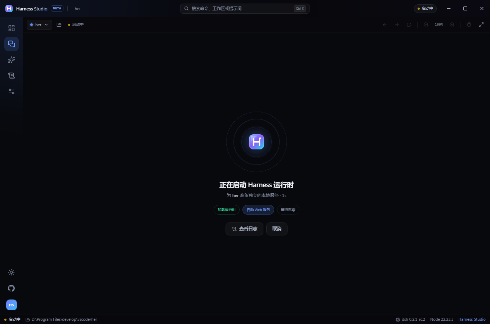
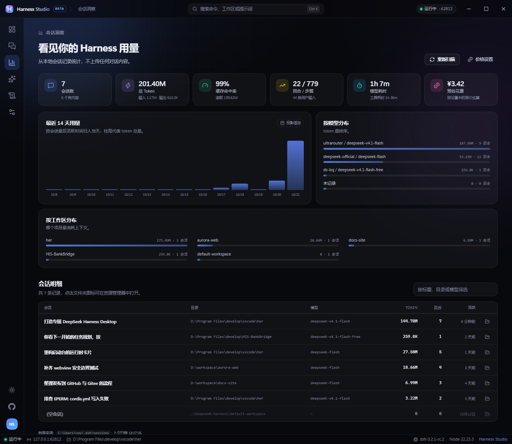
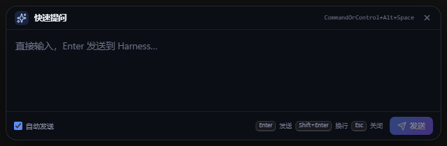
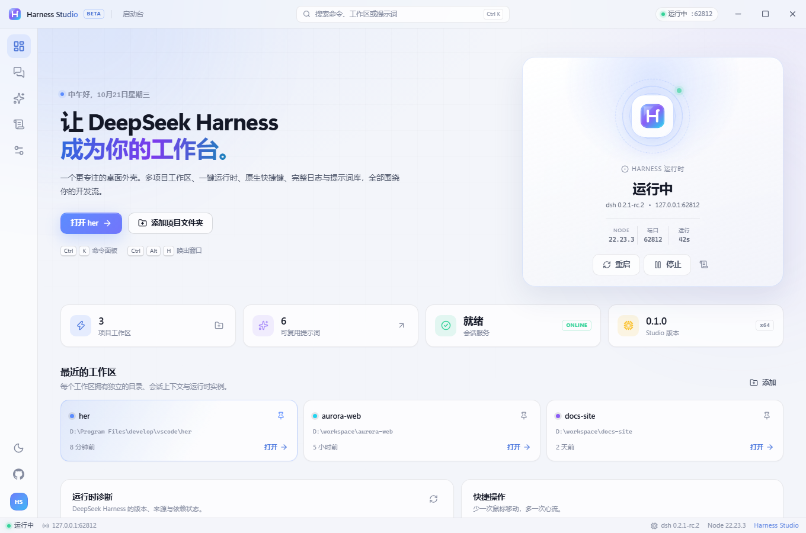

# Harness Studio · 深寻工作台

**为 DeepSeek Harness 打造的专属桌面工作台。** 不是另一个聊天客户端，而是把「项目、运行时、提示词、日志」收进一个窗口的日常开发环境。


[](https://github.com/yunhanhai/harness-studio/releases)
[](https://gitee.com/yunhanhai/harness-studio/releases)
[](https://github.com/yunhanhai/harness-studio/stargazers)

[English](README.en.md) · [下载](#下载) · [架构说明](docs/ARCHITECTURE.md) · [发布指南](docs/PUBLISHING.md) · [参与贡献](CONTRIBUTING.md) · [开发接手](docs/HANDOFF.md) · [本地安装](docs/LOCAL-INSTALL.md)

> Harness Studio 是独立的开源项目，**不是 DeepSeek 官方产品**。它复用 [DeepSeek Harness](https://github.com/deepseek-ai/deepseek-harness) 的 Web 运行时与会话能力，不包含模型权重、账号或任何闭源服务。

---

## 预览


<table>
  <tr>
    <td width="50%"></td>
    <td width="50%"></td>
  </tr>
  <tr>
    <td align="center"><sub>提示词库：把好问题沉淀成可复用资产</sub></td>
    <td align="center"><sub>命令面板：Ctrl+K 到达任何地方</sub></td>
  </tr>
</table>



---

## 为什么还要一个 Desktop？

官方 DeepSeek Harness Desktop 是一套完整、严谨的 Electron 工程：签名、更新、内置运行时、Office 运行时、平台浏览器，基础设施非常扎实。但它更偏向「把整套 Harness 交付出去」，源码构建链长，且没有面向普通用户的安装包。

Harness Studio 换了一个角度：**先让一个人每天用得顺手**。

| 日常体验 | 官方 Desktop | Harness Studio |
| --- | --- | --- |
| 获取方式 | 源码构建 | Setup 安装包 / 免安装便携版 |
| 运行时 | 随包内置、专用 profile | 自动检测本机 `dsh`，或一键安装便携运行时 |
| 多项目 | 单工作区 | 多工作区，切换时复用 Host，避免重复启动 |
| 提示词 | 无 | 内置 6 条 + 自建、标签、使用次数 |
| 日志 | 写文件，需自己找 | 实时面板、筛选、复制、令牌脱敏 |
| 会话洞察 | 无 | token / 缓存命中 / 成本估算 / 14 天趋势 / 按模型与工作区分布 |
| 全局快速提问 | 无 | `Ctrl+Alt+Space` 呼出输入框，直接发到当前会话 |
| 命令面板 | 无 | `Ctrl+K` 搜索命令 / 工作区 / 提示词 |
| 主题 | 跟随系统 | 深色 / 浅色 / 跟随系统 + 6 种强调色 |
| 托盘与全局键 | 有 | 有，且支持关闭到托盘、最小化到托盘 |
| 更新 | 官方更新通道 | 检查 GitHub Release、后台下载、重启安装 |

> 说明：官方 Desktop 在账号、强更策略、Office 技能等基础能力上更完整；Studio 的目标是把**高频开发体验**做得更轻、更快、更可定制。

---

## 功能

### 启动台

- 运行时状态、端口、版本、运行时长一屏可见
- 最近工作区按固定 / 最近使用排序
- 运行时诊断：来源、Node 版本、`DSH_HOME`、CLI 路径
- 空状态引导，第一次打开就知道下一步做什么

### 多工作区

每个工作区绑定一个项目目录，切换时**复用同一个 Host 进程**（DSH 本身是多工作区服务，每个会话自带工作目录），不会重新启动本地服务，因此切换是瞬时的。

会话、凭据仍由 `~/.dsh` 管理，与 `dsh` CLI 共用。配置档案默认使用独立的 `studio`（首次启动从 `web` 复制），避免和正在运行的 `dsh web` 争用同一个 profile。

### 会话标签页

在工作区里并排打开多个 Harness 会话：一个盯着长任务，另一个继续问别的问题，切换是瞬时的，不会重新加载。

- `Ctrl+T` 新建、`Ctrl+W` 关闭、`Ctrl+Tab` / `Ctrl+Shift+Tab` 切换，鼠标中键也能关闭；命令面板里也有对应命令；
- 标签名跟随会话标题，每个标签保留自己的会话、滚动位置与输入状态；
- 所有标签共用一个运行时，每个标签是一个独立的渲染进程，默认最多 4 个，可在「设置 → 通用 → 会话标签页」调整（1–8）；
- 新标签打开在内嵌界面上次所在的位置，在左侧会话列表里选择即可；重启运行时后会收拢成一个标签；
- 快速提问发到你正在看的那个标签；焦点在内嵌终端里时，`Ctrl+W` / `Ctrl+T` 交给终端，不会被拦截。

### 发送确认

内嵌界面按下回车就立即发送，误触无法撤回，而且队列里的待发消息会被一并提交。开启后 Studio 会在发送前问一次：

- 「每次发送前确认」——拦截回车与发送按钮，确认后才真正发出；
- 「发送会带上排队消息时额外提醒」——队列非空时，确认框明确写出「会连同 N 条排队消息一起提交」（默认开启）。

两个开关都在「设置 → 通用 → 发送确认」。拿不到确认答复时一律放行，不会因为外壳异常堵住发送。

### 一键运行时

- 自动查找：自定义路径 → 便携运行时 → npm 全局 → PATH
- 找不到时，一键下载 Node.js 并安装 `@deepseek-ai/dsh`
- 分阶段进度、可取消、超时保护、失败保留旧运行时
- 支持自定义 npm registry 与 Node 镜像

### 内嵌官方会话界面

不重写聊天 UI，不复制模型能力。Studio 用隔离的 `<webview>` 加载官方 Web UI：

- 只允许当前 Host origin；
- 新窗口、跨域导航交给系统浏览器；
- 注入减少动效、滚动条与选中色，保持与外壳一致；
- 支持缩放、前进后退、刷新、DevTools、专注模式。

### 提示词库

- 内置代码审查、重构、测试、解释代码、提交信息、需求拆解
- 标题 / 内容 / 标签，按使用次数排序
- 一键复制到剪贴板，粘贴进会话即可
- 全部本地存储，不上传

### 日志与诊断

- Host 的 stdout / stderr / 系统消息实时汇总
- 级别筛选、关键字过滤、自动跟随、一键复制
- 启动 URL 中的 `token` 自动替换为 `token=***`
- 同时写入 `host-YYYY-MM-DD.log`，退出后可查

### 会话洞察

官方 Desktop 没有。Studio 直接读取本机 `~/.dsh` 的会话数据，把用量变成可读的指标：

- **总览卡片**：会话数、总 token、缓存命中率、回合 / 步骤、模型耗时、预估花费
- **14 天趋势图**：按会话最后活跃日归入本地日历日，柱高为 token 总量
- **按模型 / 按工作区分布**：哪个 provider、哪个项目最消耗上下文
- **会话明细表**：标题、目录、模型、token、回合、活跃时间，可筛选、可打开会话目录
- **自定义单价**：设置 → 洞察里填每百万 token 的价格与货币，估算花费；全填 0 则隐藏

数据来源优先级：

1. `~/.dsh/storages/session_projcache/sessions/*.json` —— DSH 自己的会话投影缓存，含 token、回合、模型等；
2. 回退到 `~/.dsh/sessions/**/session.v*.jsonl.zstd` 的日志头，只统计会话与目录。

整个过程只读本地文件，不解析对话内容，不上传任何东西。



### 全局快速提问

在任何应用里按 `Ctrl+Alt+Space`，弹出一个输入框，写完按 Enter 直接发到当前 Harness 会话——不用切窗口。

- 自动发送：默认发送后关闭弹窗并显示主窗口，可改为只填入输入框
- 自动切换到工作区：即使你停在启动台或日志页，也会自动切过去再注入
- 最近提问：发送过的内容会被记住（默认 6 条，可调 1–20），一键回填重发
- 首次运行的说明弹窗会被自动关掉；**登录 / API Key 弹窗不会被碰**，避免误操作账号
- `Shift+Enter` 换行，`Esc` 关闭
- 行为可在「设置 → 通用 → 快速提问」调整

> 实现上不依赖 Harness 内部 RPC：Studio 聚焦 composer，通过 Chromium 真实输入事件写入文本，再点击发送按钮。上游改版时比抓私有 API 更稳。



最近提问记录保存在 `%APPDATA%\Harness Studio\quickask-recent.json`，只存文本，可随时删除。

### 占用诊断

Harness 对「一个 profile 只能被一个进程写入」和「一个会话只能被一个写入者持有」做了跨进程加锁。当你在别处还开着 `dsh web`、桌面端或另一个 Studio 时，发消息会得到「当前会话已被占用」。

Studio 让这条提示真正可操作：

- 官方那条瞬态提示既不能选中也没有关闭按钮，3 秒后自己消失。Studio 把它镜像成自己的提示：**可选中、可复制、有关闭按钮、不会自己跑掉**，并隐藏原始的那一份；
- 提示里直接带「结束其他 DSH 进程」按钮，点开就是本机的 `dsh` 进程列表；
- 「设置 → 运行时 → 其他 DSH 进程」列出每个进程的 PID、profile、Web/命令行模式与完整命令行，Studio 自己的那条会高亮且不可误杀；结束前会弹确认框；
- 如果当前权限只能看到机器的一部分进程（Low 完整性令牌），面板会明确显示琥珀色警告，而不是错误地告诉你「没有其他 DSH 进程」。

### 桌面原生能力

- 托盘菜单：打开、切换工作区、重启运行时、日志、设置、退出
- 全局快捷键：`Ctrl+Alt+H` 显示/隐藏，`Ctrl+Alt+K` 命令面板，`Ctrl+Alt+Space` 快速提问
- **崩溃自动恢复**：Host 意外退出后按 2s → 5s → 15s 自动重启，界面显示重试倒计时
- 关闭到托盘 / 最小化到托盘（首次关闭有确认）
- 开机自启、启动最小化、单实例
- 无边框窗口、自定义标题栏、窗口状态恢复

### 外观

- 深色 / 浅色 / 跟随系统
- 6 种强调色 + 自定义取色
- 界面缩放 80%–140%
- 减少动态效果
- 中英文字体回退与等宽数字



---

## 快速开始

### 下载

| 平台 | 安装版 | 便携版 |
| --- | --- | --- |
| **GitHub**（全球） | [Setup.exe](https://github.com/yunhanhai/harness-studio/releases/download/v0.1.5/Harness-Studio-0.1.5-x64-Setup.exe) | [Portable.exe](https://github.com/yunhanhai/harness-studio/releases/download/v0.1.5/Harness-Studio-0.1.5-x64-Portable.exe) |
| **Gitee**（国内更快） | [Setup.exe](https://gitee.com/yunhanhai/harness-studio/releases/download/v0.1.5/Harness-Studio-0.1.5-x64-Setup.exe) | [Portable.exe](https://gitee.com/yunhanhai/harness-studio/releases/download/v0.1.5/Harness-Studio-0.1.5-x64-Portable.exe) |

- **Setup.exe**（99 MB）— 安装版，创建开始菜单与桌面快捷方式，支持自动更新
- **Portable.exe**（99 MB）— 免安装，数据写在可执行文件旁的 `HarnessStudioData/`

完整发布页：[GitHub Releases](https://github.com/yunhanhai/harness-studio/releases) · [Gitee 发行版](https://gitee.com/yunhanhai/harness-studio/releases)

> 当前安装包未做代码签名，Windows SmartScreen 可能提示"未知发布者"。选择「更多信息 → 仍要运行」即可。介意的话可以自行从源码构建。

### 从源码安装到本机（推荐开发者）

```powershell
npm install --ignore-scripts
$env:ELECTRON_MIRROR = "https://npmmirror.com/mirrors/electron/"
node node_modules/electron/install.js
npm run install:local
```

`install:local` 会构建并**原地部署**到 `%LOCALAPPDATA%\Programs\Harness Studio`，同时创建桌面与开始菜单快捷方式。之后再改代码，重复执行这一条就能升级——旧文件会被清空覆盖，不会堆出多个副本；用户数据在 `%APPDATA%\Harness Studio`，升级不受影响。

细节见 [docs/LOCAL-INSTALL.md](docs/LOCAL-INSTALL.md)。

### 首次使用

1. 打开 Studio，点击「选择文件夹」，选一个正在开发的项目；
2. Studio 检测运行时：
   - 已安装 `dsh`：直接使用；
   - 没有：点击「一键安装」，自动准备 Node.js 与 `dsh`；
3. 进入工作区，使用 DeepSeek Harness 原本的模型与工具设置（`~/.dsh`）。Studio 默认创建独立的 `studio` 配置档案，首次启动从 `web` 复制，不会影响你现有的命令行配置；
4. 没有配置模型密钥时，按 Harness 自己的设置页提示配置。

### 从源码运行

需要 Node.js 22+ 与 npm 10+。

```powershell
git clone https://github.com/yunhanhai/harness-studio.git
cd harness-studio
npm install
$env:ELECTRON_MIRROR = "https://npmmirror.com/mirrors/electron/"
node node_modules/electron/install.js
npm run dev
```

如果 `npm install` 在受限环境里被生命周期脚本卡住：

```powershell
npm install --ignore-scripts
node node_modules/electron/install.js
```

### 打包

```powershell
$env:ELECTRON_BUILDER_BINARIES_MIRROR = "https://npmmirror.com/mirrors/electron-builder-binaries/"
npm run dist
```

产物在 `dist/`：NSIS 安装包、便携版、`latest.yml`。

---

## 工作原理

```
┌───────────────────────────────────────────────┐
│ Electron main                                 │
│  窗口 · 托盘 · 快捷键 · 设置 · Host 管理      │
└──────────────┬───────────────────┬────────────┘
               │ IPC               │ child_process
┌──────────────▼──────────┐  ┌─────▼──────────────────┐
│ React 工作台（渲染进程） │  │ dsh web（127.0.0.1）    │
│  启动台 / 提示词 / 日志  │  │  官方 Web UI 与 Agent   │
│  设置 / 命令面板 / 主题  │◄─┤  启动令牌 + Cookie      │
└─────────────────────────┘  └────────────────────────┘
```

- 主进程负责一切特权操作；渲染进程没有 Node 权限；
- 内嵌界面使用独立 session 分区，只信任当前 Host origin；
- 启动 URL 带一次性令牌，日志中自动脱敏；
- 详细设计见 [docs/ARCHITECTURE.md](docs/ARCHITECTURE.md)；想参与开发先读 [docs/HANDOFF.md](docs/HANDOFF.md)。

---

## 快捷键

| 快捷键 | 作用 |
| --- | --- |
| `Ctrl+K` | 命令面板 |
| `Ctrl+,` | 设置 |
| `Ctrl+1` / `2` / `3` | 启动台 / 工作区 / 会话洞察 |
| `Ctrl+4` / `5` | 提示词库 / 运行日志 |
| `Ctrl+T` / `Ctrl+W` | 新建 / 关闭会话标签页 |
| `Ctrl+Tab` / `Ctrl+Shift+Tab` | 下一个 / 上一个会话标签页 |
| `Ctrl+Alt+H` | 全局显示 / 隐藏窗口 |
| `Ctrl+Alt+K` | 全局打开命令面板 |
| `Ctrl+Alt+Space` | 全局快速提问（直接发到当前会话） |
| `F12` / `Ctrl+Shift+I` | 开发者工具 |

快捷键可在「设置 → 通用 → 全局快捷键」修改。

---

## 配置与数据

| 数据 | 路径 |
| --- | --- |
| 设置 | `%APPDATA%\Harness Studio\settings.json` |
| 工作区 | `%APPDATA%\Harness Studio\workspaces.json` |
| 提示词 | `%APPDATA%\Harness Studio\prompts.json` |
| 日志 | `%APPDATA%\Harness Studio\logs\` |
| 便携运行时 | `%APPDATA%\Harness Studio\runtime\` |
| DSH 会话 / 凭据 | `~/.dsh`（与 `dsh` CLI 共用） |

便携版把上述 `Harness Studio` 目录替换为可执行文件旁的 `HarnessStudioData/`。

开发时可用 `HARNESS_STUDIO_USER_DATA` 指向隔离目录：

```powershell
$env:HARNESS_STUDIO_USER_DATA = "D:\tmp\hs-dev"
npm run dev
```

---

## 开发

```powershell
npm run dev          # Electron + HMR
npm run typecheck    # 主进程 + 渲染进程
npm run build        # 构建 out/
npm run preview:ui   # 无需 Electron 的浏览器 UI 预览
npm run icons        # 从 resources/brand.svg 重新生成图标
```

浏览器预览会在 `http://127.0.0.1:4179` 用 mock API 渲染真实 React 包，适合改样式和截图。

目录：

```
src/
  main/       主进程：窗口、托盘、Host、运行时、IPC、存储
  preload/    contextBridge 白名单；workspace preload 注入主题
  renderer/   React 工作台与命令面板
  shared/     类型、默认值、IPC 通道
scripts/      图标生成、UI 预览、截图
docs/         架构、发布指南、截图
```

---

## 发布到 GitHub / Gitee

仓库已经准备好：

- `.github/workflows/ci.yml`：类型检查 + 构建
- `.github/workflows/release.yml`：打 `v*` 标签自动构建并发布 Release
- `.github/workflows/mirror-gitee.yml`：手动把仓库镜像到 Gitee
- `docs/PUBLISHING.md`：从替换占位符到双平台发布的完整步骤

仓库已配置为 `yunhanhai/harness-studio`。如果你 fork 到自己的账号，需要同步替换 4 处：

1. `src/shared/defaults.ts` 的 `GITHUB_REPO` / `GITEE_REPO`
2. `package.json` 的 `homepage` / `repository`
3. `electron-builder.yml` 的 `publish.owner`
4. 本 README 与 `README.en.md` 中的仓库链接

---

## 路线图

- [x] 会话洞察：token、缓存命中、成本、每日趋势（读取 `~/.dsh/sessions` 与投影缓存）
- [x] 自动更新：`electron-updater` + GitHub Releases
- [x] 全局快速提问：`Ctrl+Alt+Space` 呼出输入框，直接发到当前会话
- [x] Host 崩溃自动恢复：指数退避重启 + 界面倒计时
- [x] 会话标签页：一个运行时上并排打开多个会话（原计划是每个标签一个 Host，改为共用一个，原因见[架构说明](docs/ARCHITECTURE.md#会话标签页)）
- [ ] 插件市场入口与一键安装
- [ ] macOS 构建与签名
- [ ] 界面英文化

欢迎在 Issues 里投票或补充。

---

## 致谢

- [DeepSeek Harness](https://github.com/deepseek-ai/deepseek-harness) — 运行时、Agent 与 Web UI，MIT
- [Electron](https://www.electronjs.org/)、[React](https://react.dev/)、[Vite](https://vite.dev/)、[Tailwind CSS](https://tailwindcss.com/)
- [Lucide](https://lucide.dev/) 图标
- 所有提交 issue、截图和 PR 的人

## 许可

[MIT](LICENSE) © 2026 Harness Studio Contributors

## 免责声明

本项目与 DeepSeek 官方无隶属关系。「DeepSeek」「DeepSeek Harness」是其各自权利人的商标。使用本项目产生的模型调用费用、数据与合规责任由使用者自行承担。
