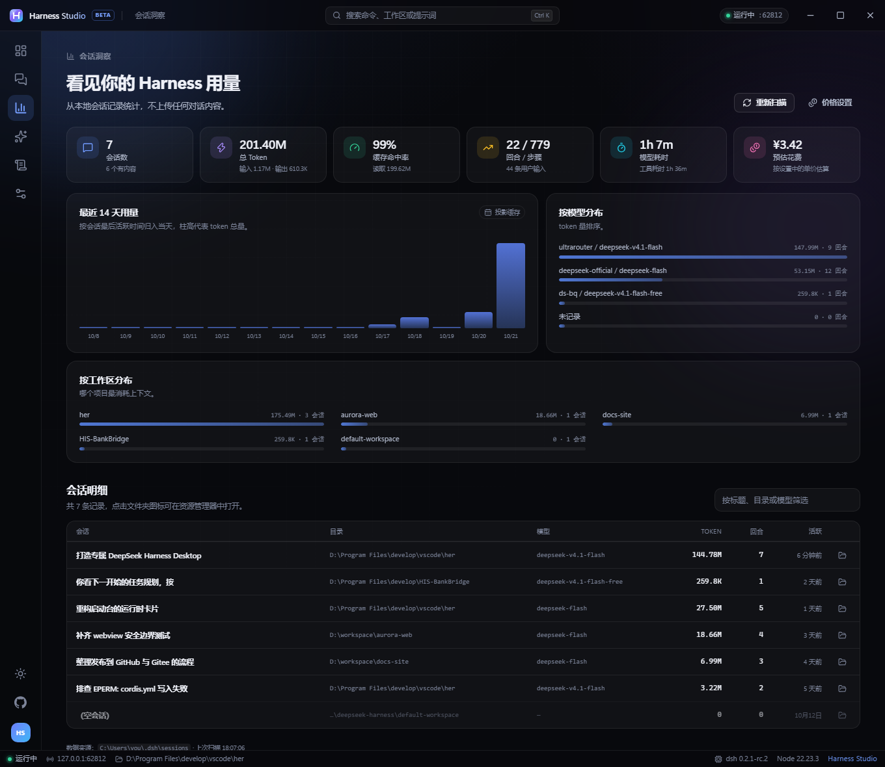
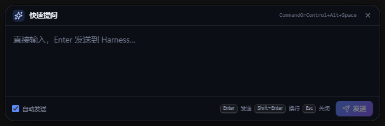
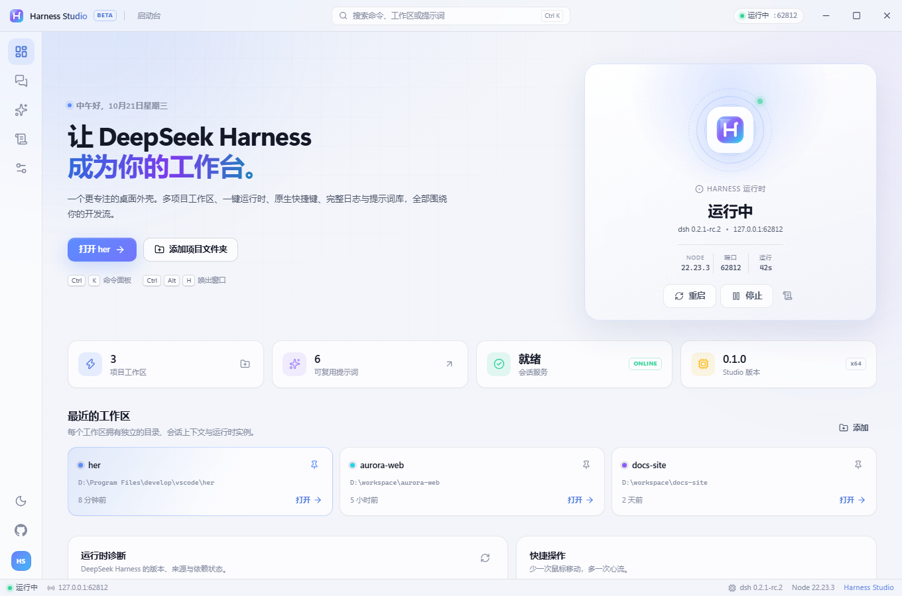

# 功能详解

[返回项目首页](../README.md) · [English](FEATURES.en.md)

本文介绍已发布功能，并保留标明“开发版”或“未发布”的开发记录。当前公开安装包为 **v0.1.12**；开发进展不表示已随该安装包发布，也不表示远端 main 已包含全部本地实现。

## 已发布功能

### 启动台

- 运行时状态、端口、版本、运行时长一屏可见
- 最近工作区按固定 / 最近使用排序
- 运行时诊断：来源、Node 版本、`DSH_HOME`、CLI 路径
- 空状态引导，第一次打开就知道下一步做什么

### 多工作区

每个工作区绑定一个项目目录。切换时，Studio 会登记目录并在**当前标签页**打开对应的 Harness 会话，核对会话的实际工作目录后更新显示；其他标签保留原会话和输入。所有标签**复用同一个 Host 进程**，切换项目不必重新启动本地服务。

在内嵌界面手动切换项目时，Studio 的项目名称和路径也会跟随更新。删除 Studio 工作区只移除书签，不会停止所有标签共用的服务。返回只有未发送草稿的旧项目时，上游可能打开新的空会话；需要保留草稿时，建议保留原标签。

会话、凭据仍由 `~/.dsh` 管理，与 `dsh` CLI 共用。配置档案默认使用独立的 `studio`（首次启动从 `web` 复制），避免和正在运行的 `dsh web` 争用同一个 profile。

### 会话标签页

在工作区里并排打开多个 Harness 会话：一个盯着长任务，另一个继续问别的问题，切换是瞬时的，不会重新加载。

- `Ctrl+T` 新建、`Ctrl+W` 关闭、`Ctrl+Tab` / `Ctrl+Shift+Tab` 切换，鼠标中键也能关闭；命令面板里也有对应命令；
- 标签名跟随会话标题，每个标签保留自己的会话、滚动位置与输入状态；
- 所有标签共用一个运行时，每个标签是一个独立的渲染进程，默认最多 4 个，可在「设置 → 通用 → 会话标签页」调整（1–8）；
- 新标签打开在内嵌界面上次所在的位置，在左侧会话列表里选择即可；重启运行时后会收拢成一个标签；
- 快速提问发到你正在看的那个标签；焦点在内嵌终端里时，`Ctrl+W` / `Ctrl+T` 交给终端，不会被拦截。

### 会话输入焦点（v0.1.10）

切换会话标签时交接输入焦点，离开工作区后输入交回 Studio；加载完成时保留正在使用的工具栏输入框。该修复从 v0.1.10 起发布，双向切换、跨页输入和发送确认的自动验收记录见 [验收文档](ACCEPTANCE.md)。

### 模型与免账号使用（v0.1.12）

新增「设置 → 模型设置」、启动台和命令面板入口。首次打开工作区可选择**使用自定义模型 / 登录 DeepSeek 账号 / 稍后配置**。第三方 API 和本地兼容服务无需 DeepSeek 账号；接口地址、协议、模型 ID 与服务要求的密钥由 Harness 原生表单管理。没有配置可用模型时，可以先写草稿和管理技能，生成回答前仍需配置并选择模型。

当前兼容层支持 OpenAI Chat Completions、OpenAI Responses 与 Anthropic Messages。本地服务若不验证密钥，可填写 `local-placeholder`；有认证时使用服务要求的密钥。工具调用、图片和推理能力取决于实际模型与接口。

### DSH 技能中心（v0.1.12）

侧栏与 `Ctrl+6` 打开技能中心，可搜索、预览正文和附带资源，查看项目/用户来源、无效声明与同名覆盖。标准项目 `.dsh/skills` 和当前 DSH_HOME 的 `skills` 支持新建、Markdown / 完整技能文件夹导入、编辑备份、删除与恢复；脚本、引用资料、二进制资源和空目录会一起保留。共享 `.agents`、自定义与随包来源只读。

清单显示默认磁盘目录与可静态识别的自定义候选，完整 preset 配置及虚拟/远程提供商尚未包含。当前会话能否调用、是否刷新，请在 Harness 的 `/` 菜单确认。备份位于 Studio 数据目录的 `skill-backups`，恢复会检查原目录与外部修改，避免覆盖后续编辑。

「插件精选」提供社区项目说明、官方发现组件文档与社区索引地址，安装仍由 Harness 管理；推荐项的组合兼容性尚未经过 Studio 验收。模型入口与技能中心已随 v0.1.12 在 GitHub、Gitee 发布。所选 Chat Completions 服务的多轮对话、技能指令与 `read` 工具验收通过；安装升级与人工键盘检查仍待补充，详见 [验收记录](ACCEPTANCE.md)。

### 插件管理（v0.1.9）

启动台快捷操作与命令面板中新增「插件管理」，会切回工作区，在当前标签页打开 Harness 自带的管理面板。运行时需要先就绪；找不到兼容入口时会提示。

插件安装、启停、配置和来源由 Harness 管理，官方目前没有默认插件市场。参见 [Harness 插件管理说明](https://github.com/deepseek-ai/deepseek-harness/blob/master/packages/client/ui-plugin-manager/README.zh.md)。插件管理入口从 v0.1.9 起提供，该版已在 GitHub 与 Gitee 发布并完成公开安装包整文件下载校验。

开发版的“技能中心 → 插件精选”支持搜索、用途筛选和版本依据查看。每项标明包版本、作者声明的 DSH 范围、许可和固定源码链接。better-sidebar `0.30.1` 与 Skills Manager `1.4.1` 在 DSH `0.2.2-rc.1` 上通过独立基础场景实测，目录列明具体范围；其余六项仍未实测。目录可离线浏览，相关来源与限定的实测范围将在后续开发文档与发行说明中公布。

### 环境诊断与配置恢复（未发布开发记录）

在“设置 → 运行时”检查已保存 Profile 的配置格式与插件依赖，保存本地配置快照，或恢复此前的配置。DSH 启动失败时，可从错误页的“诊断与恢复”进入。恢复需要先停止运行时，确认其他进程未占用，并在替换前自动保存当前配置；失败或外部修改冲突会保留恢复证据。

快照覆盖 `package.json`、`cordis.yml`、`cordis.patch.yml`、`pnpm-lock.yaml`、`pnpm-workspace.yaml`、`.npmrc`，不包含已安装依赖、技能或会话。恢复配置后，缺失依赖仍可能需要重新安装。快照保存在 Studio 数据目录的 `profile-snapshots`，可能含配置中的凭据，仅供本机恢复。本功能尚未包含在 v0.1.12 发布包中。

同一页面可停用已明确识别的社区插件，或在运行时停止后修复依赖。两种操作都会先保存配置快照。依赖修复先在临时目录下载、校验，再替换依赖，支持取消并保留旧依赖目录；完成后显示备份位置。目前支持 DSH `0.2.1-rc.2` / `0.2.2-rc.1` 的已核对配置，依赖修复限 Windows 和标准 registry 版本声明；本地路径依赖、定制 workspace 等会提示不支持。修复跳过安装脚本，仍需启动运行时确认插件兼容性。

开发版还提供“配置档案”列表：查看已保存 DSH_HOME 下的档案，区分已保存选择和当前运行，添加显示名/备注，或在停止运行时后预览并创建配置副本。备注仅保存在 Studio；副本只复制上述六个配置文件，依赖和兼容性豁免不转移，也不会自动选择或启动。两个档案仍共享同一 DSH_HOME 的全局配置和来源。相对依赖、额外环境文件或特殊 hooks/workspace 会提示不支持；配置中的凭据保留，仅供本机使用。

完全停止运行时后，可点击“选择此档案”保存已存在且可读取的 Profile。选择只更改档案名称，不自动启动；在下方检查配置与依赖，再明确启动。保存失败保留原选择，未保存的高级参数和镜像草稿也会保留。运行中的环境切换、多版本库和跨来源预设仍是后续能力。

档案操作完成后，列表和诊断会刷新当前目标。“重新检查”先检测已保存的运行时，再检查配置与依赖，失败可重试；修复改变配置后，列表会使用新修订。检查不会自动启动或安装，启动继续使用首页或工作区的明确入口。

### 发送确认

内嵌界面按下回车就立即发送，误触无法撤回，而且队列里的待发消息会被一并提交。开启后 Studio 会在发送前问一次：

- 「每次发送前确认」——拦截回车与发送按钮，确认后才真正发出；
- 「发送会带上排队消息时额外提醒」——队列非空时，确认框明确写出「会连同 N 条排队消息一起提交」（默认开启）。

两个开关都在「设置 → 通用 → 发送确认」。具体发送判定与异常处理以当前版本的 [验收记录](ACCEPTANCE.md) 为准。

### 一键运行时

- 自动查找：自定义路径 → 便携运行时 → npm 全局 → PATH
- 找不到时，一键下载 Node.js 22 并安装已验收的 `@deepseek-ai/dsh@0.2.1-rc.2`；该组合固定版本，避免上游 `latest` 的运行时要求变化影响首次安装
- 分阶段进度、可取消、超时保护、失败保留旧运行时
- 支持自定义 npm registry 与 Node 镜像

开发版增加 Node 下载的有限重试，显示当前来源、尝试次数和失败原因；连接中断或临时 HTTP 错误会重试，磁盘错误直接提示。可在运行时的镜像设置中显式开启内置 `npmmirror.com` / `nodejs.org` 后备源，默认关闭，自定义源始终不自动切换。下载超时与主动取消分别反馈，旧运行时仍在新安装验证通过后才替换。

### 内嵌官方会话界面

不重写聊天 UI，不复制模型能力。Studio 用隔离的 `<webview>` 加载官方 Web UI：

- 只允许当前 Host origin；
- 新窗口、跨域导航交给系统浏览器；
- 注入减少动效、滚动条与选中色，保持与外壳一致；
- 支持缩放、前进后退、刷新、DevTools、专注模式。

### 提示词库

- 内置代码审查、重构、测试、解释代码、提交信息、需求拆解
- 标题 / 内容 / 标签，按使用次数排序
- 一键复制到剪贴板，粘贴进会话即可
- 全部本地存储，不上传

### 日志与诊断

- Host 的 stdout / stderr / 系统消息实时汇总
- 级别筛选、关键字过滤、自动跟随、一键复制
- 启动 URL 中的 `token` 自动替换为 `token=***`
- 同时写入 `host-YYYY-MM-DD.log`，退出后可查

### 会话洞察

Studio 直接读取本机 `~/.dsh` 的会话数据，把用量变成可读的指标：

- **总览卡片**：会话数、总 token、缓存命中率、回合 / 步骤、模型耗时、预估花费
- **14 天趋势图**：按会话最后活跃日归入本地日历日，柱高为 token 总量
- **按模型 / 按工作区分布**：哪个 provider、哪个项目最消耗上下文
- **会话明细表**：标题、目录、模型、token、回合、活跃时间，可筛选、可打开会话目录
- **自定义单价**：设置 → 洞察里填每百万 token 的价格与货币，估算花费；全填 0 则隐藏

数据来源优先级：

1. `~/.dsh/storages/session_projcache/sessions/*.json` —— DSH 自己的会话投影缓存，含 token、回合、模型等；
2. 回退到 `~/.dsh/sessions/**/session.v*.jsonl.zstd` 的日志头，只统计会话与目录。

整个过程只读本地文件，不解析对话内容，不上传任何东西。



### 全局快速提问

在任何应用里按 `Ctrl+Alt+Space`，弹出一个输入框，写完按 Enter 直接发到当前 Harness 会话——不用切窗口。

- 自动发送：默认发送后关闭弹窗并显示主窗口，可改为只填入输入框
- 自动切换到工作区：即使你停在启动台或日志页，也会自动切过去再注入
- 最近提问：发送过的内容会被记住（默认 6 条，可调 1–20），一键回填重发
- 首次运行的说明弹窗会被自动关掉；**登录 / API Key 弹窗不会被碰**，避免误操作账号
- `Shift+Enter` 换行，`Esc` 关闭
- 行为可在「设置 → 通用 → 快速提问」调整

> 快速提问使用当前标签页的会话输入框；具体行为会随上游界面兼容性更新。



最近提问记录保存在 `%APPDATA%\Harness Studio\quickask-recent.json`，只存文本，可随时删除。

### 占用诊断

Harness 对「一个 profile 只能被一个进程写入」和「一个会话只能被一个写入者持有」做了跨进程加锁。当你在别处还开着 `dsh web`、桌面端或另一个 Studio 时，发消息会得到「当前会话已被占用」。

Studio 让这条提示真正可操作：

- 官方那条瞬态提示既不能选中也没有关闭按钮，3 秒后自己消失。Studio 把它镜像成自己的提示：**可选中、可复制、有关闭按钮、不会自己跑掉**，并隐藏原始的那一份；
- 提示里直接带「结束其他 DSH 进程」按钮，点开就是本机的 `dsh` 进程列表；
- 「设置 → 运行时 → 其他 DSH 进程」列出每个进程的 PID、profile、Web/命令行模式与完整命令行，Studio 自己的那条会高亮且不可误杀；结束前会弹确认框；
- 如果当前权限只能看到机器的一部分进程（Low 完整性令牌），面板会明确显示琥珀色警告，而不是错误地告诉你「没有其他 DSH 进程」。

### 桌面原生能力

- 托盘菜单：打开、切换工作区、重启运行时、日志、设置、退出
- 全局快捷键：`Ctrl+Alt+H` 显示/隐藏，`Ctrl+Alt+K` 命令面板，`Ctrl+Alt+Space` 快速提问
- **崩溃自动恢复**：Host 意外退出后按 2s → 5s → 15s 自动重启，界面显示重试倒计时
- 关闭到托盘 / 最小化到托盘（首次关闭有确认）
- 开机自启、启动最小化、单实例
- 无边框窗口、自定义标题栏、窗口状态恢复

### 外观

- 深色 / 浅色 / 跟随系统
- 6 种强调色 + 自定义取色
- 界面缩放 80%–140%
- 会话阅读字号（v0.1.11）：跟随 Harness、14、16、18 px，保存后所有会话正文立即更新，可恢复默认
- 减少动态效果
- 中英文字体回退与等宽数字



### 界面语言（v0.1.8）

在「设置 → 通用 → 界面语言」选择中文、English 或跟随系统，选择会保存并同步到主窗口、命令面板和快速提问。切换语言不会重新加载会话，也不会清掉输入和设置草稿。

Studio 的页面、日期格式、托盘、菜单及确认框使用所选语言；Harness 内嵌界面、用户会话、已保存提示词与原始日志保持原样。已有错误和安装进度快照保留生成时的语言。界面语言从 v0.1.8 起提供，GitHub 和 Gitee 均可下载新版。

## 运行方式与数据

```
┌───────────────────────────────────────────────┐
│ Electron main                                 │
│  窗口 · 托盘 · 快捷键 · 设置 · Host 管理      │
└──────────────┬───────────────────┬────────────┘
               │ IPC               │ child_process
┌──────────────▼──────────┐  ┌─────▼──────────────────┐
│ React 工作台（渲染进程） │  │ dsh web（127.0.0.1）    │
│  启动台 / 提示词 / 日志  │  │  官方 Web UI 与 Agent   │
│  设置 / 命令面板 / 主题  │◄─┤  启动令牌 + Cookie      │
└─────────────────────────┘  └────────────────────────┘
```

- 主进程负责一切特权操作；渲染进程没有 Node 权限；
- 内嵌界面使用独立 session 分区，只信任当前 Host origin；
- 启动 URL 带一次性令牌，日志中自动脱敏；
- 详细设计见 [docs/ARCHITECTURE.md](ARCHITECTURE.md)；想参与开发先读 [docs/HANDOFF.md](HANDOFF.md)。

| 数据 | 路径 |
| --- | --- |
| 设置 | `%APPDATA%\Harness Studio\settings.json` |
| 工作区 | `%APPDATA%\Harness Studio\workspaces.json` |
| 提示词 | `%APPDATA%\Harness Studio\prompts.json` |
| 日志 | `%APPDATA%\Harness Studio\logs\` |
| 便携运行时 | `%APPDATA%\Harness Studio\runtime\` |
| DSH 会话 / 凭据 | `~/.dsh`（与 `dsh` CLI 共用） |

便携版把上述 `Harness Studio` 目录替换为可执行文件旁的 `HarnessStudioData/`。

开发时可用 `HARNESS_STUDIO_USER_DATA` 指向隔离目录：

```powershell
$env:HARNESS_STUDIO_USER_DATA = "D:\tmp\hs-dev"
npm run dev
```
